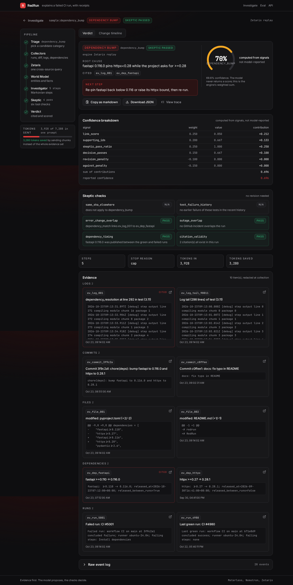
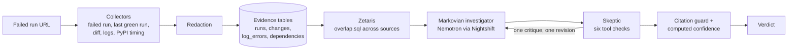

# RedRun

**A red CI run, explained like a senior engineer would explain it.**

You push a commit, GitHub Actions goes red, and you get 4,000 lines of log. Was it your change? A dependency that shipped a new release overnight? A secret that expired? A flaky test? GitHub having a bad day?

RedRun answers that question for you. Give it a failed run and it comes back with:

- **the cause**, from a fixed list (bad commit, dependency bump, config change, expired or missing secret, flaky test, infrastructure outage, or an honest `unknown`)
- **the reason**, in plain words
- **the evidence**, every claim linked to a real log line, diff or release record
- **a confidence score it can justify**, built from named signals, never guessed by the model
- **one next step** you can actually take

Built solo for the **Open Agent Hackathon 2026, Track 2: The Agent That Can Explain Why**.



---

## Why this is hard (and why one big prompt isn't enough)

The answer to "why did it fail?" almost never sits in the log alone. It sits in the *overlap* between sources: the log names `fastapi`, the diff loosened the `fastapi` pin, and PyPI shows a new `fastapi` release landed between the last green run and this red one. Each fact is boring on its own. Together, they're the explanation.

So RedRun doesn't paste a log into a model and hope. It collects the evidence first, joins it with one cross-source query, lets an investigator reason over it in small pieces, and then has a skeptic try to knock the answer down before you ever see it.

## How it works



1. **Collect.** Deterministic collectors pull the failed run, the last green run of the same workflow on the same branch, the commit and file diff between them, error windows from the failed job logs, and PyPI release dates for any dependency that changed.
2. **Redact.** Secrets are stripped before anything is stored, traced, cached or sent to a model.
3. **Store as evidence.** Everything lands in four tables per run (`runs`, `changes`, `log_errors`, `dependencies`), written as Parquet under `data/<trace_id>/`.
4. **Join across sources.** One SQL query, [`redrun/queries/overlap.sql`](redrun/queries/overlap.sql), links a log error to a dependency released between the runs, to a changed file, to a workflow change, or to a runner difference. It runs on **Zetaris**.
5. **Investigate in chunks.** The **Markovian investigator** reads the evidence in ordered chunks. Each model call sees one chunk plus a small carried-over state, never the whole run, so long logs don't blow up the context.
6. **Push back.** The **skeptic** runs six checks on the proposed verdict: did the same commit pass elsewhere, what's this test's history, does the error actually overlap the change, was there a GitHub incident, does the dependency timing line up, are the citations real. A decisive failure sends one critique back for exactly one revision. Fail twice and the answer becomes `unknown`, with the reason.
7. **Guard the output.** A verdict may only cite evidence ids that exist in this run, and any cause other than `unknown` must cite at least one. Confidence is computed from named signals in `confidence_breakdown`. If the model tries to hand back its own score, it's stripped and logged.

Every stage writes to a JSONL trace in `logs/` and to a live event stream, so you can watch the agents work.

## Sponsor technology, and what each one actually does here

### Meterless: Nightshift is the AI provider, and Markovian is the reasoning engine

- **Nightshift is RedRun's primary (and default) provider.** RedRun talks to the Nightshift runtime's OpenAI-compatible endpoint at `127.0.0.1:8088/v1` with the runtime token. The NVIDIA key lives inside Nightshift's Providers tab, never in this repo.
- **Two Nemotron lanes, both served through Nightshift:**
  - fast lane: `nvidia/nemotron-3.5-bolt-e4b`
  - deep lane: `nvidia/nemotron-3-ultra-550b-a55b`
- **Markovian Agent Engine.** The investigator follows Meterless's Markovian pattern: bounded context per step, a capped carryover state between steps, and engine reporting. `metrics.markovian` records steps, stop reason, tokens in, what a single all-evidence prompt would have cost, and `tokens_saved`.
- `python -m redrun meterless-check` proves the runtime is live: it lists the models, sends one real completion, prints the model that actually answered, and masks the token. It never falls back silently.

Live check, 27 Oct 2026 ([full output](docs/evidence/meterless-check-live.txt)):

```text
provider     : meterless
base url     : http://127.0.0.1:8088/v1
status       : online
models       : 86 from GET /v1/models
chat HTTP    : 200
chat model   : nvidia/nemotron-3.5-bolt-e4b
chat latency : 1907 ms
```

### Zetaris: the evidence layer, queried in place

- RedRun doesn't copy rows into Zetaris. For each run it creates a Lightning database and registers the four Parquet files **in place** as FILESTORE tables, then runs `overlap.sql` against them.
- Zetaris is where the cross-source join happens: logs, diffs and package releases are separate sources, and the overlap query is what turns them into ranked links.
- `metrics.query_engine` always tells you the truth: `zetaris` for a live query, `zetaris_replay` for a recorded one, `duckdb` or `duckdb_fallback` when Zetaris isn't configured. A recording is never passed off as a live query.

Live check, 27 Oct 2026 ([full output](docs/evidence/zetaris-check-live.txt)):

```text
zetaris status : online
SELECT 1       : 1 row(s) in 109ms
registration   : method=in_place database=redrun_17f50513e80c
overlap.sql    : engine=zetaris rows=1 links=1 skipped=0
  dependency_match  0.85  log error names package fastapi which changed >=0.110 -> 0.116.0
                          and that release landed between the green and failed runs
```

### NVIDIA: Nemotron does all the reasoning

Every model call RedRun makes, investigator, revision and baseline alike, is answered by an NVIDIA Nemotron model, routed through Nightshift.

### Cursor

Cursor became optional for this event and no Cursor credits were issued, so RedRun was built with other AI coding tools.

---

## Does it actually work? The evaluation

Fifteen real GitHub Actions failures, each with a known cause:

- **12 built on purpose** in [cipoklean/redrun-lab](https://github.com/cipoklean/redrun-lab), a tiny package where each branch has a green run followed by a real breaking commit: a loosened pin, a resolver conflict, a logic bug, a rename, a syntax error, two flaky tests, a missing secret, an invalid token, a Python version change, an env var and a working directory.
- **2 public runs** that line up with a GitHub Actions incident and later passed on the same commit.
- **1 public run** with no usable signal, where `unknown` is the right answer.

The dev/holdout split was drawn from a fixed seed before anything ran, and a test recomputes the draw, so the holdout can't quietly move.

RedRun is compared against a fair baseline: one plain Nemotron call on the same fast lane, given the last 300 redacted log lines and the same list of causes. No collectors, no evidence tables, no cross-source query, no skeptic.

Every number here was recorded live: both lanes served by Nemotron through Meterless Nightshift, with the evidence tables registered and queried in Zetaris.

| | RedRun agent | Plain model baseline |
| --- | --- | --- |
| Right cause (all 15) | **14/15 (93.3%)** | 13/15 (86.7%) |
| Right cause, held-out 5 | **5/5** | 3/5 |
| Named a cause instead of `unknown` | **14/15** | 12/15 |
| Right when it named a cause | 13/14 | **12/12** |
| Explanation hits every root-cause keyword | 8/15 | 8/15 |
| Verdicts with valid citations | 15/15 | not asked to cite |
| Mean confidence, right vs wrong | 0.49 vs 0.27 | no score |

This is a close race, and it should read as one. The baseline is strong: it never named a wrong cause, but it answered `unknown` on two cases the agent solved from evidence outside the log, a misconfigured env var and a GitHub outage. RedRun's edge is coverage, the held-out cases, and an answer that cites its evidence and carries a confidence that drops when it's unsure. Its one miss is `dep_bump_unpinned`: a loosened pin let a breaking release in, and it called that `config_change` instead of `dependency_bump`, at a low 0.27.

An earlier run had the baseline at 11/15. The field test below found that the log tail both systems read was mostly post-job cleanup. Fixing that helped the baseline as much as the agent, so these are the fair numbers.

The cost is real: a median of about 56 seconds of model time per investigation against about 5 seconds for the baseline, because RedRun reasons in several Markovian steps and has a skeptic check every claim. The full report covers calibration, latency, tokens and a confusion matrix, per split: [`eval/RESULTS.md`](eval/RESULTS.md).

### Field test: four failures it had never seen

To check that the eval isn't the whole story, RedRun was pointed at four real failed runs from my own repositories, none of them in the eval or the samples, each with a known outcome.

| Run | What actually happened | RedRun's verdict |
| --- | --- | --- |
| sweepr, a Rust CLI | `mod tui` landed before `ratatui` was added to `Cargo.toml` | `bad_commit` (0.70): names the missing `ratatui` dependency |
| ugbo | a new test imported the package, and CI ran bare `pytest` | `bad_commit` (0.75): right commit, but the explanation never names the import error |
| chog-mischief | a scheduled keep-awake ping timed out against an external endpoint; the same commit passed before | `infra_outage` (0.36): an upstream service, no code change |
| closebook | one of 1,006 tests hit a sqlite error right after a commit touching that code; the next run passed | `bad_commit` (0.55): defensible at failure time, but probably a flake |

The first pass went worse: one of four right, two `unknown`s, and a wrong explanation. The logs showed why, and the fixes are general, not tuned to these runs: colour codes hid Rust's compiler errors from the extractor, a URL in an echoed step script was read as a timeout, the log tail was all post-job cleanup, a workflow's first run had no diff to look at, and an outage only counted if GitHub itself had an incident. After the fixes, three of four are right, the eval was re-recorded live, and closebook is still an honest judgment call.

Run it yourself, offline, in seconds:

```bash
python -m redrun eval --split all --mode replay --baseline
```

---

## Try it in two minutes (no keys, no network)

Needs Python 3.11+.

```bash
git clone https://github.com/cipoklean/redrun && cd redrun
python -m venv .venv && source .venv/bin/activate
pip install -e ".[dev]"

pytest
SAMPLE_MODE=true python -m redrun investigate --sample dependency_bump
SAMPLE_MODE=true python -m redrun investigate --sample bad_commit --json
```

Sample cases: `dependency_bump`, `bad_commit`, `expired_or_missing_secret`, `flaky_test`. Each run writes its full trace to `logs/<trace_id>.jsonl`.

## Run it for real

### 1. Configure

```bash
cp .env.example .env
```

| Variable | What it's for |
| --- | --- |
| `GITHUB_TOKEN` | Reading runs, logs and diffs |
| `LLM_PROVIDER` | `meterless` (default) or `nvidia` |
| `METERLESS_BASE_URL` | `http://127.0.0.1:8088/v1` |
| `METERLESS_RUNTIME_TOKEN` | From Nightshift, Setup > Providers |
| `METERLESS_FAST_MODEL` | `nvidia/nemotron-3.5-bolt-e4b` |
| `METERLESS_DEEP_MODEL` | `nvidia/nemotron-3-ultra-550b-a55b` |
| `ZETARIS_ENABLED`, `ZETARIS_URL`, `ZETARIS_USER`, `ZETARIS_PASSWORD` | Your Zetaris instance |
| `ZETARIS_DATA_ROOT` | Where Zetaris sees RedRun's `data/` folder |

Never commit `.env`. Only `.env.example`, with placeholders, is in the repo.

### 2. Check both sponsors are live

```bash
python -m redrun meterless-check
python -m redrun zetaris-check --sample dependency_bump
```

Each one exits non-zero and says `offline` or `unauthorized` instead of pretending.

### 3. Investigate a run

```bash
SAMPLE_MODE=false python -m redrun investigate https://github.com/owner/repo/actions/runs/123456
SAMPLE_MODE=false python -m redrun investigate owner/repo   # latest failed run on the default branch
```

### Running Zetaris in a Codespace with Nightshift on your laptop

This is how RedRun was actually run during the hackathon: Zetaris needs more memory than an 8 GB laptop has, and Nightshift is a desktop app.

1. Start Zetaris in a GitHub Codespace (4-core / 16 GB) and bind-mount RedRun's `data/` into it at `/home/zetaris/customer-data/shared/redrun` (read only).
2. Keep Nightshift running on your laptop.
3. From the laptop, open a reverse tunnel so the Codespace can reach Nightshift:

   ```powershell
   gh codespace ssh -- -R 8088:127.0.0.1:8088
   ```

4. In that window, `127.0.0.1:8088` now reaches Nightshift. Run `meterless-check`, then investigate.

<details>
<summary>Zetaris setup notes (Lightning 2.4.x)</summary>

- `POST /api/auth/login` returns `idToken`, `refreshToken` and `orgId`. Every `/api/proxy` call needs an `X-Org-ID` header, and the adapter sends the one from the login response.
- Lightning rejects plain `CREATE TABLE`, so RedRun never loads rows one by one.
- Local file tables must live under Zetaris's file root, `/home/zetaris/customer-data/shared`.
- Lightning rejects a query that starts with `WITH`, so `overlap.sql` is one flat `SELECT` with derived tables, and uses `CAST(... AS STRING)` rather than `VARCHAR`.
- Per run, RedRun issues:

  ```sql
  CREATE LIGHTNING DATABASE redrun_<trace> DESCRIBE BY 'RedRun evidence'
  CREATE LIGHTNING FILESTORE TABLE runs FROM redrun_<trace>
    FORMAT PARQUET OPTIONS (path "/home/zetaris/customer-data/shared/redrun/<trace>/runs.parquet")
  ```

  and the same for `changes`, `log_errors` and `dependencies`. Re-registering a run is fine; any other DDL error fails loudly.

</details>

## The interface

React, Vite, TypeScript and Tailwind, served by FastAPI from the same container.

- **`/`**: paste a run URL or `owner/repo`, see the provider status, or pick a sample.
- **`/run/<trace_id>`**: watch the investigation live. The pipeline lights up stage by stage, each investigator step shows its lane, model, tokens and carryover, skeptic checks appear as pass, fail or n/a, and a critique is drawn as an arrow back to the investigator. When it finishes, the page becomes the verdict: cause, root cause with clickable evidence chips, next step, the confidence gauge and its breakdown, evidence grouped by kind, and a timeline from the last green run to the red one.
- **`/eval`**: the evaluation, agent beside baseline, per split and per case.

```bash
cd frontend
npm install
npm run build     # FastAPI then serves frontend/dist at /
npm run dev       # hot reload on :5173, API proxied to :8001
```

If vite complains about a missing esbuild binary, run `npm rebuild esbuild`.

## API

```bash
SAMPLE_MODE=true uvicorn redrun.api.app:app --port 8000

curl -s localhost:8000/health
curl -s localhost:8000/provider/status
curl -s -X POST localhost:8000/run -H 'content-type: application/json' \
  -d '{"sample":"expired_or_missing_secret"}'

# watch a run as it happens
curl -sN -X POST localhost:8000/run/stream -H 'content-type: application/json' \
  -d '{"sample":"flaky_test"}'

# replay a finished run's events
curl -sN localhost:8000/run/<trace_id>/events
```

## Docker

```bash
cp .env.example .env
docker compose up --build
```

Traces land in `./logs`. Inside the container, Nightshift is reached at `http://host.docker.internal:8088/v1`, and compose sets that for you.

## Recording new cases

```bash
python -m redrun record-sample <run-url> --name my_case
SAMPLE_MODE=false python eval/lab/record_eval.py --force --nightshift   # re-record all 15
```

A recording keeps the redacted collector outputs, the Zetaris result, the skeptic's inputs and every model step, so `SAMPLE_MODE=true` can replay it with no network. `--nightshift` refuses to run unless the provider is Meterless, and each step stores the model the runtime reports it actually used. The token is never written anywhere.

## Tests

```bash
pytest                                   # backend, including the frozen contract
cd frontend && npx vitest run            # verdict rendering, evidence links, confidence sums
cd frontend && npx playwright test       # end to end: run a sample, land on a verdict, click a citation
```

`docs/contract.md` is the frozen wire format and `docs/schemas/` holds the JSON Schemas. Tests fail if either drifts from the code, and the frontend's types are generated from the same schemas.

## Repository map

```text
redrun/
  collectors/   failed run, last green run, diff, logs, PyPI timing
  adapters/     GitHub, PyPI, GitHub status, LLM (Nightshift or NVIDIA), Zetaris, DuckDB, replay
  agents/       investigator (Markovian) and skeptic
  queries/      overlap.sql, the cross-source join
  core/         the frozen data models
  eval/         eval runner, baseline, report, Nightshift lane plan
  api/          FastAPI app and live event stream
frontend/       React UI
samples/        recorded cases for offline replay
eval/           case set, results, lab scripts
docs/           contract, schemas, screenshots, live evidence
logs/           JSONL traces, one per run
```

## Built during the hackathon

RedRun is new work, written from scratch between 22 and 27 October 2026. Nothing was carried over from an earlier project. It relies only on open-source libraries (FastAPI, DuckDB, pydantic, httpx, React and friends).

## What's next

- Run as a GitHub App that comments the verdict on the failed PR
- Learn each repo's flaky-test history over time, so "flaky" stops being a guess
- More sources in the Zetaris join: Dependabot alerts, cloud status pages, self-hosted runner metrics
- Suggested fix PRs for the easy causes, like a pin that needs tightening

---

Made by [@cipoklean](https://github.com/cipoklean).
